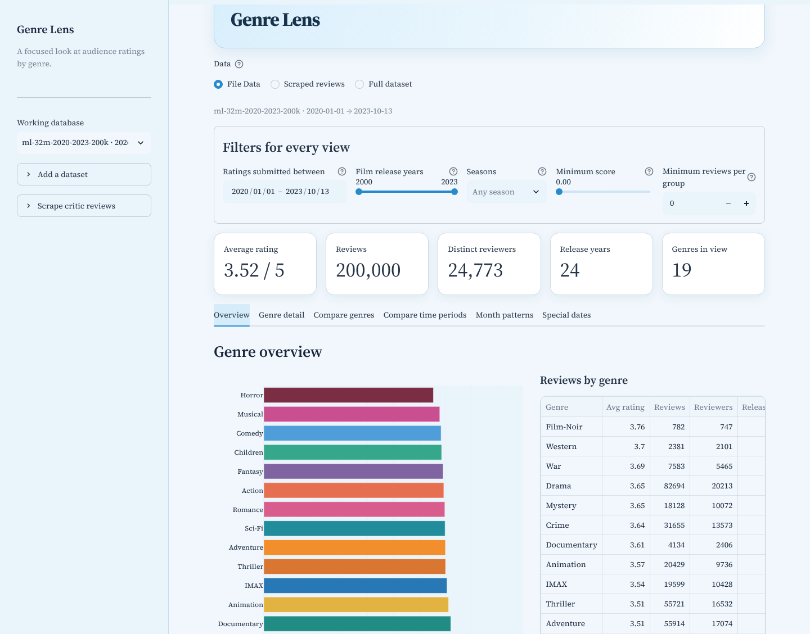

# Genre Lens 🎞️

An interactive Streamlit dashboard for exploring **which film genres people watch and rate, and how that changes over time**. It is built on MovieLens ratings and can add **critic review scores scraped from Wikipedia and Wikidata** for recent films (2020 to now), so trends continue past the end of the MovieLens data.

*PDS301m project.*



## Features

- **Six views:** genre overview, one-genre detail, genre vs. genre, time-period comparison (year, month, season, weekday, day of month, special date), month-by-month patterns and holiday periods (Valentine's Day, Lunar New Year / Tết, Halloween, Christmas…).
- **Shared filters** for every view: rating date range, film release years, seasons, minimum score and minimum reviews per group.
- **Three data choices:** **File Data** (your MovieLens snapshot), **Scraped reviews** (critic scores only) or **Full dataset** (both added together).
- **Web scraper** with a per-run limit, cancel button and resume, so runs stay short.
- **Fast:** the selected dataset is loaded into memory once, so filter changes take well under a second on 500k ratings. Only the open tab is calculated, and a loading bar shows when the app is working.

## Project structure

```
Movie_Rating/
├── main.py              # Streamlit app: layout, filters, tabs and charts
├── data_store.py        # Imports MovieLens CSVs into SQLite snapshots; reference SQL queries; special dates
├── fast_queries.py      # In-memory (NumPy/pandas) versions of the queries used by the app
├── web_scraper.py       # Scrapes film lists + critic scores and builds the "Scraped" / "Full" datasets
├── requirements.txt
├── .streamlit/
│   └── config.toml      # Theme (colours, font)
├── data/
│   └── datasets/        # MovieLens CSV folders (movies.csv + ratings.csv + README.txt)
├── docs/
│   └── screenshot.png
└── databases/           # Created by the app (snapshots, scraped reviews); not in git
```

## Getting started

Requires **Python 3.10 or newer** (developed with 3.11).

**Windows (PowerShell)**

```powershell
git clone https://github.com/Bkhau12/Genre_Lens.git
cd Genre_Lens
python -m venv .venv
.\.venv\Scripts\Activate.ps1
python -m pip install -r requirements.txt
python -m streamlit run main.py
```

If PowerShell blocks `Activate.ps1`, run `Set-ExecutionPolicy -Scope CurrentUser RemoteSigned` once, or skip activation and use `.\.venv\Scripts\python.exe` in place of `python`.

**macOS / Linux**

```bash
git clone https://github.com/Bkhau12/Genre_Lens.git
cd Genre_Lens
python3 -m venv .venv
source .venv/bin/activate
python -m pip install -r requirements.txt
python -m streamlit run main.py
```

The app opens at http://localhost:8501.

## Using the app

1. **Import a dataset.** In the sidebar, open **Add a dataset**, pick a folder from `data/datasets` and press **Import selected folder**. This creates a SQLite snapshot in `databases/cache` (a few seconds). You can also upload your own `movies.csv` + `ratings.csv` in MovieLens format.
2. **Scrape critic reviews (optional).** Open **Scrape critic reviews**, choose the release years and **Max films per run**, and press **Scrape latest data**. Each run checks up to that many films that have not been checked yet, spread across the chosen years. Press it again to continue. **Cancel scraping** stops at once and keeps what is already saved.
3. **Choose the data** above the filters: **File Data**, **Scraped reviews** or **Full dataset**.
4. Set the **filters** and explore the tabs.

### Included datasets

| Folder | Ratings | Users | Films | Rating dates |
|---|---:|---:|---:|---|
| `ml-latest-small` | 100,836 | 610 | 9,742 | 1996-03-29 → 2018-09-24 |
| `ml-32m-2020-2023-200k` | 200,000 | 24,773 | 14,043 | 2020-01-01 → 2023-10-13 |
| `ml-32m-2000-2023-500k` | 500,000 | 100,947 | 17,025 | 2000-01-18 → 2023-10-13 |
| `ml-32m-2000-2023-1m` | 1,000,000 | 120,637 | 22,324 | 1999-10-02 → 2023-10-13 |

The three `ml-32m-*` folders are random samples of [MovieLens 32M](https://grouplens.org/datasets/movielens/32m/), whose ratings end in October 2023. `ml-32m-2020-2023-200k` holds 200,000 ratings sampled from the 238,669 ratings dated 2020 or later in the 1m sample; pair it with the scraped reviews (**Full dataset**) to follow genres from 2020 to today.

## How it works

### 1. Importing (`data_store.py`)
`create_snapshot` reads `movies.csv` and `ratings.csv` into a SQLite database with four tables: `movies`, `movie_genres` (one row per film per genre), `ratings` and `metadata`. The release year is taken from the title, e.g. `Heat (1995)`.

### 2. Filtering fast (`fast_queries.py`)
When a dataset is opened, its ratings are read into memory once as NumPy columns, sorted by date, with year, month, weekday and day worked out up front. Each filter then builds a **True/False mask over all ratings at once**:

```python
mask = np.ones(data.size, dtype=bool)
if minimum_score > 0:
    mask &= data.rating >= minimum_score
if release_years:
    mask &= (data.release >= release_years[0]) & (data.release <= release_years[1])
if months:                                   # seasons
    mask &= np.isin(data.month, months)
lo, hi = np.searchsorted(data.timestamp, [start, end])   # date range: binary search on sorted dates
mask[:lo] = False; mask[hi:] = False
```

The ratings still marked True are grouped with pandas (`groupby(...).agg(...)`) into averages, counts and distinct reviewers. A film with several genres counts once in each of its genres, which is why the per-genre review counts add up to more than the total. `data_store.py` keeps the same queries written in SQL; both give identical results.

`main.py` caches every result with `st.cache_data`, and the tabs use `st.tabs(..., on_change="rerun")` so only the selected tab is computed.

### 3. Scraping critic reviews (`web_scraper.py`)
1. **Film lists:** downloads Wikipedia's *List of American films of YEAR* pages through the MediaWiki API and parses the release tables with BeautifulSoup. Merged month and day cells are expanded to give every film its title and release date.
2. **Genres and scores:** looks each film up on Wikidata (50 at a time) for its genres (`P136`) and its review scores (`P444`) from Rotten Tomatoes (Tomatometer %) and Metacritic (Metascore /100).
3. **Same scale as MovieLens:** each score becomes one review on the 0.5–5 scale, rounded to the nearest half star, dated on the film's release date.

| Score | → 0.5–5 |
|---|---|
| 82% | 4.0 |
| 93% | 4.5 |
| 52/100 | 2.5 |

Requests use a descriptive User-Agent, a short pause between calls and at most three downloads at once. Films not released yet are skipped until they come out.

### 4. Combining the data
`build_review_view` writes the scraped reviews in the same snapshot format, so every view works unchanged. Each critic site counts as one reviewer. For **Full dataset**, it copies your snapshot and adds the reviews. Films already in your catalog are matched by title and year and keep their MovieLens id and genres, so nothing is counted twice. New films get genres mapped from Wikidata labels (e.g. *romantic comedy film* → Romance, Comedy).

## Where data is stored

Everything the app creates goes in `databases/` inside the project, which is listed in `.gitignore`:

- `databases/cache/` — imported snapshots
- `databases/web_scrape/critic_reviews.sqlite3` — scraped films and scores
- `databases/web_scrape/review_view_*.sqlite3` — the Scraped / Full datasets, rebuilt automatically

Delete the `databases` folder to start fresh. Snapshots from older versions of the app in `../02_Databases` are still found.

## Notes and limitations

- MovieLens rating dates are when a user **submitted** a rating, not when they watched the film.
- Scraped reviews are critic scores per film (up to two per film), so there are far fewer of them than MovieLens ratings. Their date is the film's release date. From 2024 on, results rest on critic scores only.
- The scraper reads US film lists, and not every film has a Rotten Tomatoes or Metacritic score on Wikidata.
- Dates use UTC. Thanksgiving and Mother's/Father's Day follow US dates.

## Troubleshooting

| Problem | Fix |
|---|---|
| `No module named 'bs4'` or `requests` | Stop the app and run `python -m pip install -r requirements.txt` in the same terminal and environment. |
| `st.tabs() got an unexpected keyword argument 'on_change'` | Streamlit is too old: `python -m pip install -U "streamlit>=1.65"`. |
| A scrape run finds 0 films | Check your internet connection. If Wikipedia changed its table layout, `parse_film_list_page` in `web_scraper.py` may need updating. |
| Changes in a file seem to disappear | An editor tab with an older copy may have saved over it. Reload the file from disk before saving. |

## Data sources and credits

- **MovieLens** — F. Maxwell Harper and Joseph A. Konstan. 2015. *The MovieLens Datasets: History and Context.* ACM Transactions on Interactive Intelligent Systems 5, 4: 19:1–19:19. https://doi.org/10.1145/2827872. The data is redistributed under its original license (see the `README.txt` in each dataset folder): research use only, no commercial use, no endorsement by the University of Minnesota or GroupLens implied.
- **Wikipedia** film lists — text available under [CC BY-SA 4.0](https://creativecommons.org/licenses/by-sa/4.0/).
- **Wikidata** genres and review scores — [CC0](https://creativecommons.org/publicdomain/zero/1.0/). Scores originate from Rotten Tomatoes and Metacritic.
